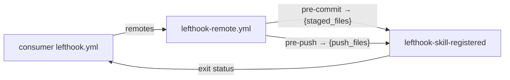
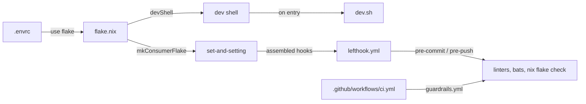

# nix-lefthook-skill-registered

<!-- hallucinogen:autonomy-disclaimer start -->
> Read [LLM-DISCLAIMER](docs/LLM-DISCLAIMER.md) first. This repository is
> tended by an autonomous loop, and that file says what the loop may do here,
> what it may not, and what to check before trusting anything in this tree.
<!-- hallucinogen:autonomy-disclaimer end -->

[](https://github.com/pr0d1r2/nix-lefthook-skill-registered/actions/workflows/ci.yml) [](https://nixos.org)

> This code is LLM-generated and validated through an automated integration
> process using [lefthook](https://github.com/evilmartians/lefthook) git hooks,
> [bats](https://github.com/bats-core/bats-core) unit tests, and GitHub Actions CI.

Lefthook-compatible file-registry check, packaged as a Nix flake.

Verifies that files under a directory are registered (referenced) in a parent
index file. Useful for enforcing that new documentation pages, skill files, or
module definitions are always wired into a central manifest.

## Example

Given this structure:

```text
docs/skills/git.md
docs/skills/nix.md
docs/index.md        # must contain @./skills/git.md and @./skills/nix.md
```

Configure:

```bash
export LEFTHOOK_SKILL_REGISTERED_FILE=docs/index.md
export LEFTHOOK_SKILL_REGISTERED_PREFIX='@./skills/'
export LEFTHOOK_SKILL_REGISTERED_STRIP='docs/skills/'
```

Adding `docs/skills/docker.md` without a matching `@./skills/docker.md` line
in `docs/index.md` will fail the hook.

## Architecture



## Usage

### Option A: Lefthook remote (recommended)

```yaml
remotes:
  - git_url: https://github.com/pr0d1r2/nix-lefthook-skill-registered
    ref: main
    configs:
      - lefthook-remote.yml
```

You **must** also set a `glob` in your local config to scope which files
trigger the check:

```yaml
pre-commit:
  commands:
    skill-registered:
      glob: "docs/skills/**/*.md"
      run: timeout 30 lefthook-skill-registered {staged_files}
```

### Option B: Flake input

```nix
inputs.nix-lefthook-skill-registered = {
  url = "github:pr0d1r2/nix-lefthook-skill-registered";
  inputs.nixpkgs.follows = "nixpkgs";
};
```

### Configuration

| Variable | Default | Description |
|----------|---------|-------------|
| `LEFTHOOK_SKILL_REGISTERED_TIMEOUT` | `30` | Timeout in seconds |
| `LEFTHOOK_SKILL_REGISTERED_FILE` | *(required)* | Registry file path (relative to repo root) |
| `LEFTHOOK_SKILL_REGISTERED_PREFIX` | *(required)* | Expected import line prefix |
| `LEFTHOOK_SKILL_REGISTERED_STRIP` | *(required)* | Directory prefix to strip from file paths |
| `LEFTHOOK_SKILL_REGISTERED_ROOT` | git root | Override repo root (for testing) |

## Development architecture



## License

MIT
